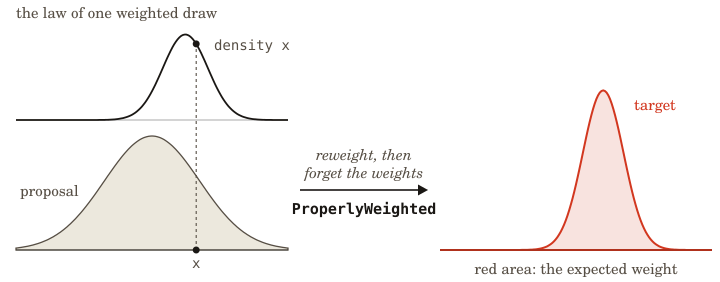

<p align="center">
  
</p>

- **Purpose:** Probability theory for proving probabilistic programs and
  inference algorithms correct.

`problib` is a Lean 4 library of the probability theory needed to give
probabilistic programming languages precise meaning, and to prove facts about
their programs.

It contains foundational theory of the real numbers, measures and integrals,
probability kernels, conditioning, and the conditions under which Monte Carlo
inference is correct. Every theorem in the library rests on Lean's three
standard axioms (`propext`, `Quot.sound`, and `Classical.choice`), and the
library builds all requisite statements without Mathlib (mostly, for speed of
compilation: we sync and take content from Mathlib where required, with proper
license attribution).

## Install

The source archive is attached to the GitHub release, and `gh` downloads it:

```sh
gh release download v26.10.1 --repo a-tiny-project/problib --pattern 'problib-v26.10.1.tar.gz'
tar -xzf problib-v26.10.1.tar.gz
```

The extracted directory is a Nix flake. `nix build` builds the library and runs
its checks. `nix develop` enters a shell with Lake and the Lean release that
`lean-toolchain` pins (`leanprover/lean4:v4.34.1`). The `lake` commands below
run from the archive root, inside that shell.

## Use

Problib makes usage of a `Trust` framework, which audits what each declaration's
proof depends on. From the package root, this builds the library and runs the
audit under Lean 4.34.1, pinned in `lean-toolchain`:

```sh
lake build Problib Problib.Axioms
```

The audit checks every declaration, including Lean's generated auxiliaries, and
rejects extra axioms, unsafe declarations, and `sorry`.

```lean
import Problib

open Problib.Real Problib.Measure Problib.Inference

-- Importance sampling: a draw from the proposal, weighted by the target's
-- density against it, has expected weight equal to the target's total mass.
example {α : Type} {space : Space α} {target proposal : Measure space}
    (probability : Measure.IsProbability proposal) {density : α → NNReal}
    (measurable : MeasurableMap space weightSpace density)
    (exact : target = proposal.withDensity (fun x => ENNReal.finite (density x))) :
    lintegral (proposal.map (fun x => (x, density x))
        (Space.pair_measurable (MeasurableMap.identity space) measurable))
      drawWeight = target Set.univ :=
  properlyWeighted_mass (importance_weighted probability measurable exact)

#print axioms Problib.Inference.importance_weighted
```

Saved as `Example.lean` in the package root, the file compiles with
`lake env lean Example.lean` and prints:

```
'Problib.Inference.importance_weighted' depends on axioms: [propext, Classical.choice, Quot.sound]
```

A value with a finite nonnegative weight is a _weighted draw_.
`importance_weighted` proves that a proposal draw weighted by the target's
density over the proposal's has a _probability law_ (the distribution of one
weighted draw) that is `ProperlyWeighted` for the target.
`properlyWeighted_mass` turns that into the example's statement, that the
expected weight is the target's total mass. `#print axioms` lists only Lean's
three standard axioms.

## How it works

<p align="center"></p>

<p align="center"><em>For a proposal draw <code>x</code> paired with <code>density x</code>, where <code>density</code> is the target's density relative to the proposal, <code>importance_weighted</code> proves that the pair's law is <code>Properly weighted</code> for the target. Reweighting that law by its weights, then forgetting the weights, gives back the target, and the expected weight is the target's total mass. The shaded neutral curve is the proposal, the unfilled curve the weight, and red the target with its mass. The dashed line pairs <code>x</code> with its weight.</em></p>

Under a properly weighted law, the expected value of the weight times `f` of the
draw equals the integral of `f` under the target, for every nonnegative
measurable `f`. With `f = 1`, the expected weight is the target's total mass, so
a properly weighted law carries the target's scale as well as its shape.

Importance sampling is the simplest case. Proper weighting composes by
multiplying weights and carries through populations, resampling, and sequential
Monte Carlo under stated conditions.

## Limits

- The real-number layer defines no metric, topology, or general sequence limit.
- The integral definition of pi agrees with the trigonometric one: it is the
  least positive zero of sine. Agreement with the unit disk's area is unproved.
- Representing continuous programs in Church, a probabilistic language with
  higher-order functions, remains open.
- The convergence theorems require a _minorization_: some iterate of the kernel
  is bounded below by a fixed measure. Chains with random-walk proposals on
  unbounded spaces have no convergence theorem yet.
- Kallenberg's randomization lemma proves a measurable function exists but gives
  no algorithm for finding it.

## Code

problib is constructed in layers that build on each other:

- [Real](Problib/Real.lean): Dedekind reals and nonnegative extended reals.
- [Analysis](Problib/Analysis.lean): calculus, densities, Gaussian integrals.
- [Measure](Problib/Measure.lean): integration, kernels, conditioning,
  randomization, Markov chains.
- [QuasiBorel](Problib/QuasiBorel.lean): quasi-Borel spaces, probability with
  functions as values.
- [Inference](Problib/Inference.lean): weighting, resampling, sequential Monte
  Carlo, Metropolis–Hastings.
- [Axioms](Problib/Axioms.lean): the audit.

## References

- [Kallenberg 2021](https://doi.org/10.1007/978-3-030-61871-1): the
  randomization lemma.
- [Heunen, Kammar, Staton, and Yang 2017](https://doi.org/10.1109/LICS.2017.8005137):
  quasi-Borel spaces.

## License

AGPL-3.0-or-later. See [LICENSE](LICENSE).
